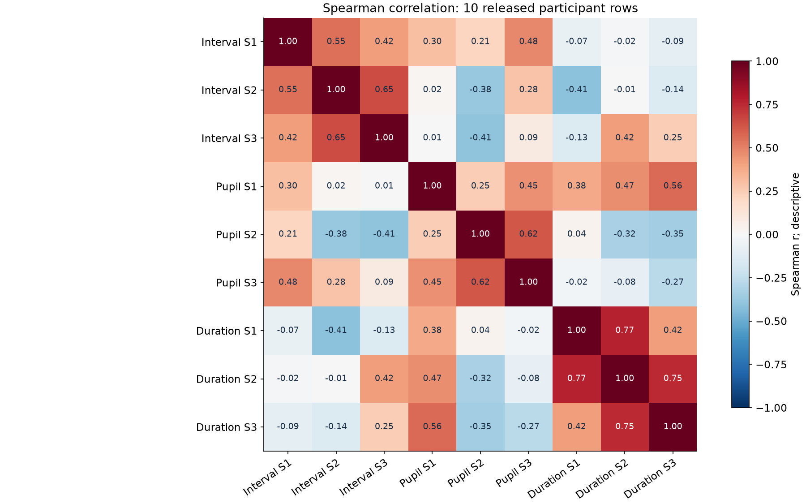
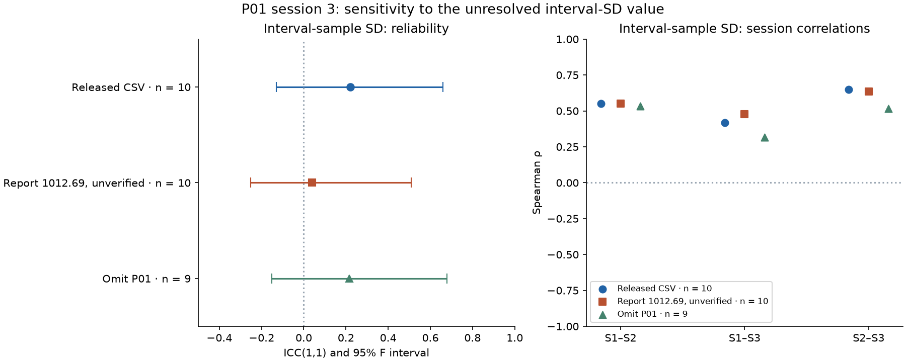
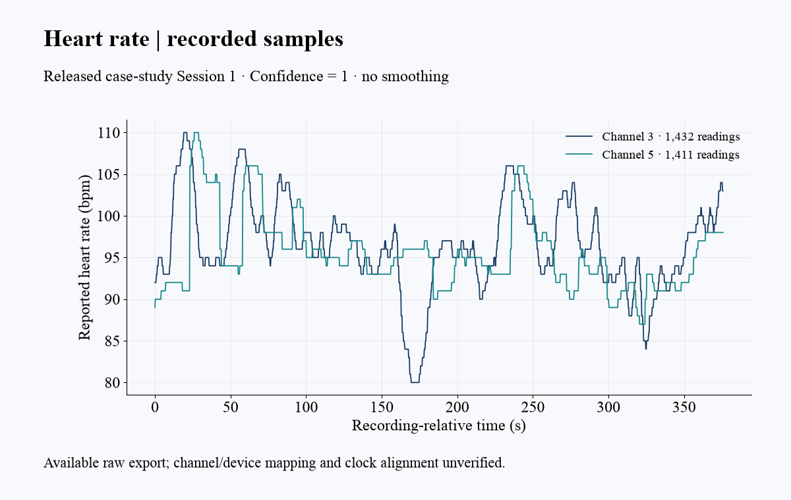
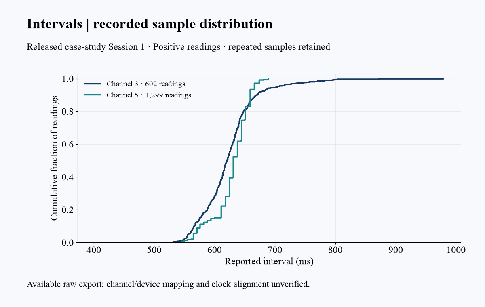
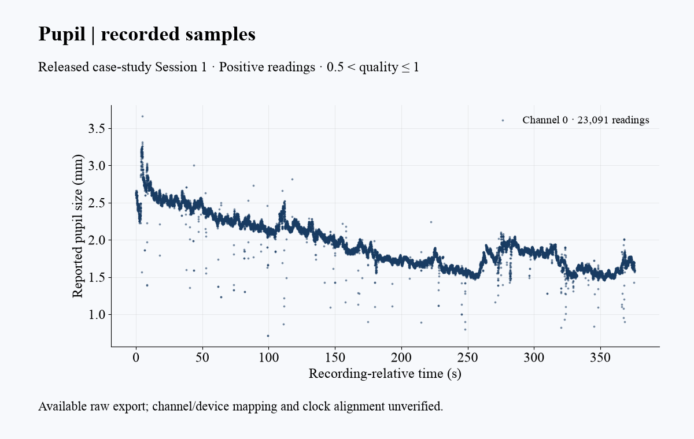

# Multimodal-Multisensor

Eye, cardiac and questionnaire data from a study of 10 adults across three weekly sessions. The release includes available recordings, saved results and reports.

**Keywords:** Eye tracking · Cardiac intervals · Questionnaires · Session reliability

## Pipeline


[Full-size diagram](images/pipeline.svg) · [Edit in Figma](https://www.figma.com/design/2fRPk2Ky5TkaEtweHzj5Wz?node-id=5-2)

[Pipeline source](pipeline.mmd)

## Run

Run from the repository root with Python 3.11 or 3.12. These commands build the documentation; analysis code and notebooks were removed.

```bash
python -m venv .venv
source .venv/bin/activate
python -m pip install -r requirements-dev.txt
python -m pytest tests -q
python scripts/build_docs.py
python -m http.server 8000 --directory build/docs
```

Open <http://localhost:8000>.

## Results

**Study:** 10 adults × 3 sessions. **Release:** 24 raw sensor streams.

Saved ICC(1,1) estimates describe the reliability of within-session standard deviations in the released group tables.

| Within-session standard deviation | ICC(1,1) | 95% interval |
| :--- | ---: | :--- |
| Interval samples | 0.22 | −0.13 to 0.66 |
| Pupil diameter | 0.45 | 0.07 to 0.79 |
| Response duration | 0.61 | 0.25 to 0.87 |

Descriptive results; no diagnostic validation. Most participant summaries lack raw-data mappings. Clock alignment and unique-beat timing are unverified. [Methods and limits](docs/FIGURES.md) · [Report corrections](docs/REPORT_STATUS.md).






**Case-study Session 1**







## Tech Stack

| Scope | Tools |
| :--- | :--- |
| Current documentation | Python 3.11/3.12 · Mistune · pytest · HTML/CSS |
| [Archived analysis](https://github.com/urmeo/multimodal-multisensor/tree/0f2b1cc55409b1b68bc9ee52341382263fa4559e) | NumPy · pandas · SciPy · Matplotlib · scikit-learn |

## Roadmap

These steps require source evidence that is currently unavailable.

- Document participant-to-recording mappings under the recorded consent.
- Reassess P01 if the original export becomes available.
- Verify acquisition timezones and clock synchronization.
- Validate unique-beat timestamps and record interval corrections.
- Confirm eye-openness units and polarity with labeled calibration frames.

## References

1. [Technical report](docs/reports/Multimodal%20Multisensor%20Technical%20Report.pdf)
2. [Thesis](docs/reports/Thesis%20Report.pdf)
3. [Proposed protocol](docs/reports/CYPSY_Poster.pdf)
4. [Dataset citation](CITATION.cff)

## License

[Code: MIT](LICENSE) · [Data, image and questionnaire terms](DATA_ETHICS.md)
