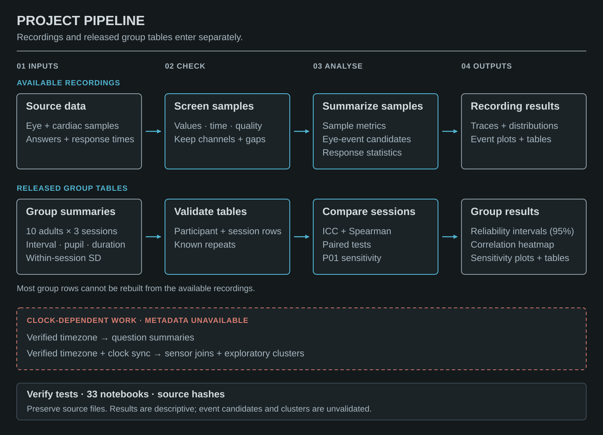
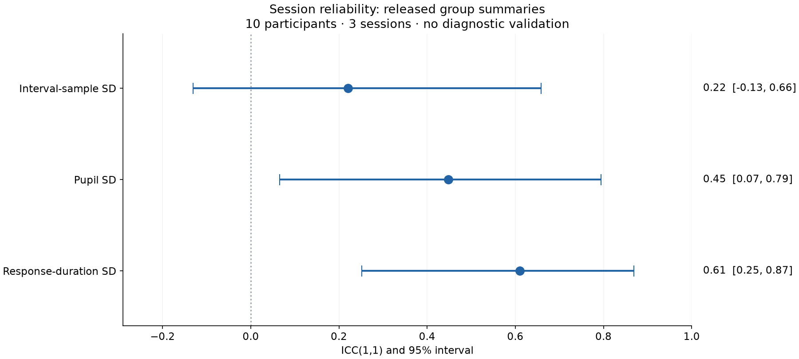

# Multimodal-Multisensor

Python analysis of eye, cardiac and questionnaire data from 10 adults across three weekly sessions. The code checks recordings, measures within-session variation and compares session summaries.

**Keywords:** Physiological signals · Reliability analysis · PCA · scikit-learn



[View full size](images/pipeline.svg) · [Edit in Figma](https://www.figma.com/board/hexcUfwWED4MIu7wjxmWrU/) · [Design files](design/README.md)

The repository includes 24 raw sensor streams and 22 Jupyter notebooks. Eye and cardiac recordings are available. GSR collection was attempted; facial integration was unfinished.

The shared `mms` package uses NumPy, pandas and SciPy for analysis, Matplotlib for plots and scikit-learn for exploratory clustering. The questionnaires include HADS, STAI-S, STAI-T, BFI-10 and the Fear Questionnaire.

## Run the analysis

Use Python 3.11 or 3.12. Run from the repository root:

```bash
python -m venv .venv
source .venv/bin/activate
python -m pip install \
  'numpy>=1.26,<3' 'pandas>=2.0,<3' 'pytz>=2020.1' \
  'scipy>=1.11,<2' 'matplotlib>=3.8,<4' 'scikit-learn>=1.4,<2' \
  'pytest>=7.4' 'nbformat>=5.9' 'nbmake>=1.5' 'ipykernel>=6.25' \
  'jupyterlab>=4.6.4' 'mistune==3.3.3'
export PYTHONPATH="$PWD${PYTHONPATH:+:$PYTHONPATH}"
python -m pytest tests -q
python -m scripts.build_group_summaries --check
python -m scripts.build_figures --check
python -m scripts.build_recording_figures --check
python -m scripts.build_group_sensitivity --check
python scripts/verify_notebooks.py
python scripts/build_docs.py
jupyter lab notebooks
```

The checks leave source data unchanged. The documentation build writes to `build/docs`. For notebook exports, set `MMS_OUTPUT_ROOT` to a directory outside `data/`; otherwise exports stay disabled.

To save new figures, sensitivity results and timestamp-shifted copies separately:

```bash
python -m scripts.build_figures --output-root outputs/local/figures
python -m scripts.build_recording_figures --output-root outputs/local/recordings
python -m scripts.build_group_sensitivity --output-root outputs/local/sensitivity
python -m scripts.deidentify_timestamps --output-root outputs/local/time-copies
```

## Results and limitations

The released group tables give the following ICC(1,1) estimates for the session-to-session reliability of within-session standard deviations. Each estimate uses 10 participant rows across three sessions and a 95% confidence interval.

| Within-session standard deviation | ICC | 95% interval |
| :--- | ---: | :--- |
| Interval samples | 0.22 | −0.13 to 0.66 |
| Pupil diameter | 0.45 | 0.07 to 0.79 |
| Response duration | 0.61 | 0.25 to 0.87 |



These calculations describe the released tables. The small sample and wide intervals do not establish diagnostic accuracy or stable traits. The [Spearman correlation plot](outputs/correlation.png) is also descriptive.

- Repeated cardiac interval samples are not verified unique beats. Cross-stream clock alignment is unverified.
- Two equality patterns in the group tables are suspected duplicates. Most participant rows cannot be reconstructed from the available raw recordings.
- The case-study summaries numerically match group row P02. That match does not independently confirm participant identity.

The [figure notes](docs/FIGURES.md) record source hashes, filters and historical images, including photographs of the experimental setup.

## Documentation and data use

[Browse the documentation](https://urmeo.github.io/multimodal-multisensor/) for the workflow, figures and data notes.

The original [technical report](docs/reports/Multimodal%20Multisensor%20Technical%20Report.pdf), [thesis](docs/reports/Thesis%20Report.pdf) and [proposed protocol](docs/reports/CYPSY_Poster.pdf) are preserved. Read the [report corrections](docs/REPORT_STATUS.md) alongside them.

The author records consent for sharing and session photographs. Dates, device labels, responses and recognizable photos remain in the release; participant codes do not make it anonymous. Review the [data use and consent notes](DATA_ETHICS.md) before reuse. Code and notebooks use the [MIT license](LICENSE). Cite the data using [CITATION.cff](CITATION.cff).
