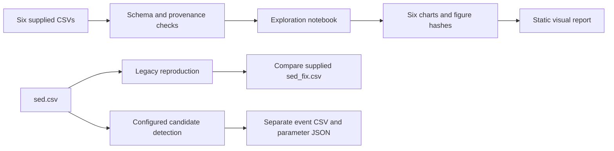

# Analysis pipeline

The six current relative-time source files stay in `data/`. Calendar originals are retained privately outside the repository; existing history and earlier copies are unaffected. The notebook
produces six descriptive charts; it does not train a classifier.

`sed_fix.csv` supplies the notebook's historical run histogram. Reproducing its
flags does not validate fixation accuracy. Candidate events use a separate
command and are not included in the six charts. Supplied eye summaries and
questionnaire timing are independent inputs; clock alignment and summary
aggregation remain unverified.

See [Run the analysis](../README.md#run-the-analysis) for setup, checks and figure commands.

| Folder | Contents |
| --- | --- |
| `data/` | Six source CSVs, field dictionary and recording manifest |
| `notebooks/` | Descriptive analysis and chart definitions |
| `scripts/` | Summary checks, sensitivity analysis, timestamp copies, figure generation and documentation |
| `tests/` | Source contracts and synthetic regression cases |
| `docs/figures/` | Versioned chart previews and their hash manifest |
| `docs/reviews/` | Original historical PDFs |
| `docs/images/` | Reviewed product images and their credits |
| `docs/index.html` | Static visual report |
| `outputs/` | Local exports, including candidate events and relative-time copies |
